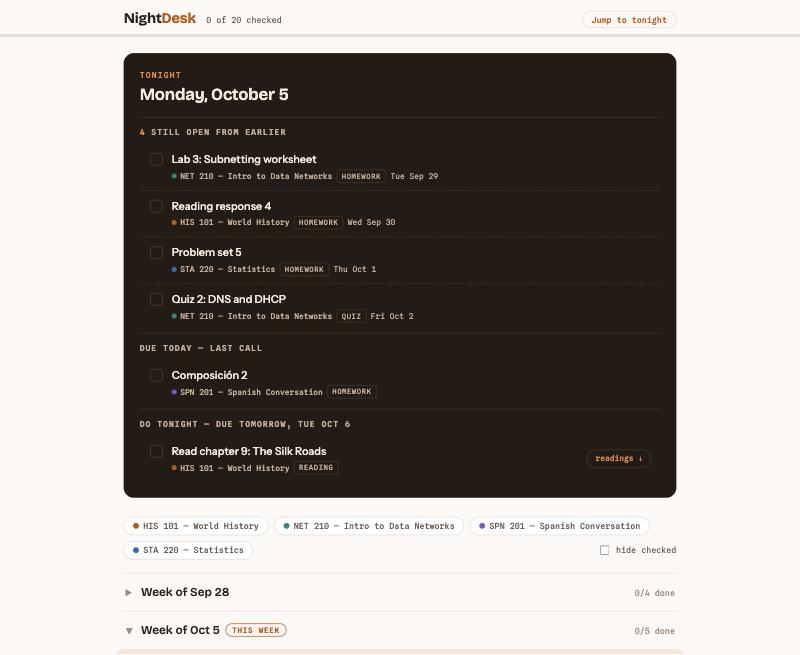

# Night Desk

[](https://github.com/maxcamplese/night-desk/actions/workflows/ci.yml)

A one-page nightly checklist for a semester's assignments, plus a pipeline that turns reading PDFs into audiobooks you can listen to offline. I built it for my own semester; this public version runs on a fictional sample semester.



**The checklist page** opens to *Tonight*: what is still open, what is due today, and what to do tonight for tomorrow. Below that are filters by class, the semester by week, and an optional course reader that lists readings with links. Check-offs save in the browser. The page is one self-contained HTML file, with no server or account.

**The audio pipeline** goes from PDF to text to speech:
1. Pull the text out of a PDF, or OCR it if it's a scan.
2. Clean it for listening: drop cover pages, page numbers, running headers, citations, links, and the reference list.
3. Rewrite text for speech, so "WWII" is read as "World War Two" and "Louis XIV" as "Louis the Fourteenth".
4. Render tagged `.m4a` files with the offline [Piper](https://github.com/OHF-Voice/piper1-gpl) voice engine.

## Setup

Requires Node.js 20 or newer. The audio rendering also needs Python 3.9 or newer; OCR needs macOS.

```bash
git clone https://github.com/maxcamplese/night-desk.git
cd night-desk
npm install
```

## Usage

### Build the Checklist Page

```bash
npm run build          # builds the sample semester into dist/index.html
open dist/index.html
```

From your own [Class Manager](https://github.com/maxcamplese/class-manager) data (**Settings > Export backup**):

```bash
node tools/from-class-manager.mjs class-manager-backup.json > my-assignments.json
node tools/build-page.mjs --assignments my-assignments.json --footer "Spring 2027 · 5 classes"
```

Files named `*-backup*.json` and `my-*.json` are git-ignored, so personal data stays out of the repo. The format for adding a course reader is in [`demo/reader.json`](demo/reader.json).

### Turn Readings into Audio

```bash
# 1. PDFs -> cleaned, speech-ready text (scans are reported as "no text")
node audio/clean-text.mjs readings/ texts/

# 2. Optional, macOS: OCR a scanned PDF first
swiftc -O audio/ocr_pdf.swift -o ocr_pdf
./ocr_pdf readings/scanned.pdf texts/scanned.txt
node audio/normalize.mjs texts/

# 3. Text -> .m4a with Piper (one-time setup, about 60 MB for the voice)
python3 -m venv .venv
.venv/bin/pip install piper-tts mutagen
.venv/bin/python -m piper.download_voices en_US-lessac-medium
.venv/bin/python audio/render_audio.py --texts texts/ --out audio-out/ \
    --model en_US-lessac-medium.onnx --album "HIS 101 readings"
```

Rendering skips files that already exist, so an interrupted run can be resumed.

Only use the audio pipeline with readings you have the right to copy for personal use, and don't share the audio files. `readings/`, `texts/`, PDFs, and audio files are git-ignored for that reason.

## Tests

```bash
npm test
```

The tests cover page building (including that a title can't break out of the page's script tag), the Class Manager converter, the speech rewrites, and the text cleaner. CI also type-checks the OCR tool on macOS.

## Known Limitations

- **Keep the Piper install path short.** Piper's pronunciation engine, espeak-ng, stores its data path in a fixed-size buffer. A virtual environment in a deeply nested folder fails with `Error processing file .../phontab`. A `.venv` inside this repo works, and `render_audio.py` warns when the path is too long.
- **The text cleaner is tuned for typeset journal articles.** PDFs in monospaced fonts can get stray spaces inside words ("m iles").
- **OCR quality varies.** Vision OCR is good on clean scans and weak on small or unusual fonts. Read the text before rendering hours of audio.
- **Check-offs live in one browser.** They don't sync, and clearing site data clears them.
- **Speech rewrites are English-only** and cover common cases, not every abbreviation.

## License

MIT. See [LICENSE](LICENSE).
